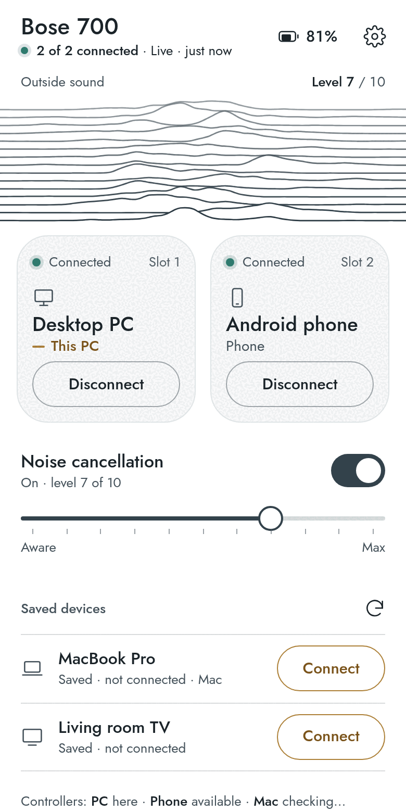
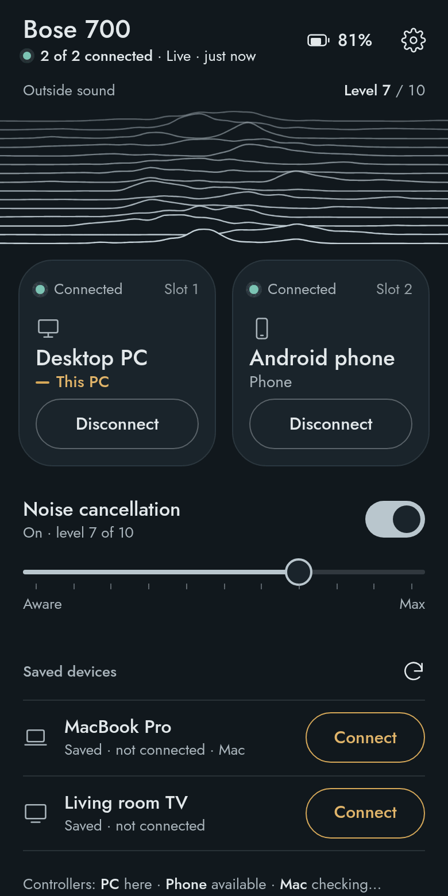
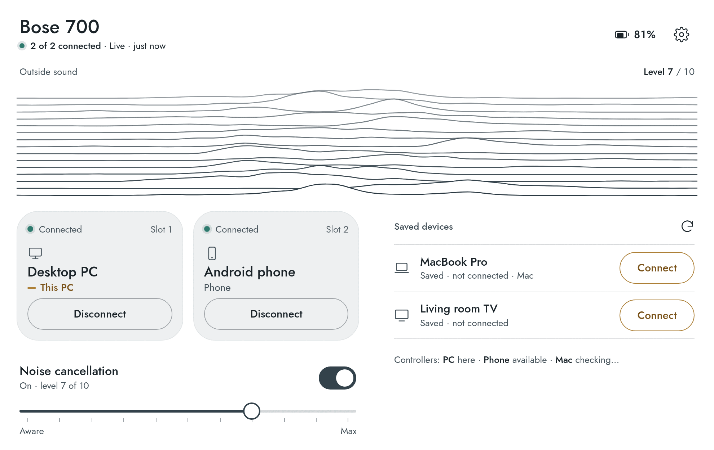
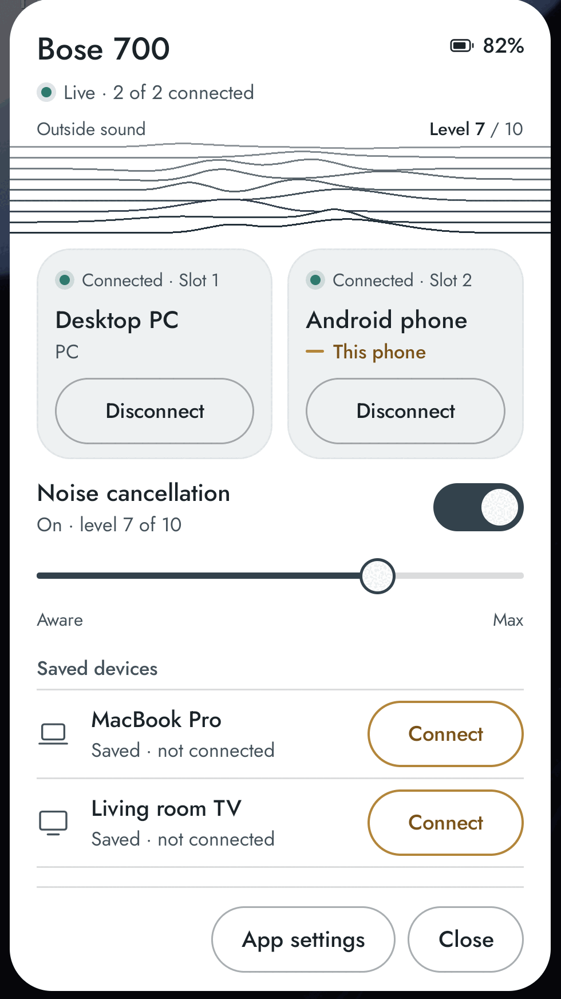
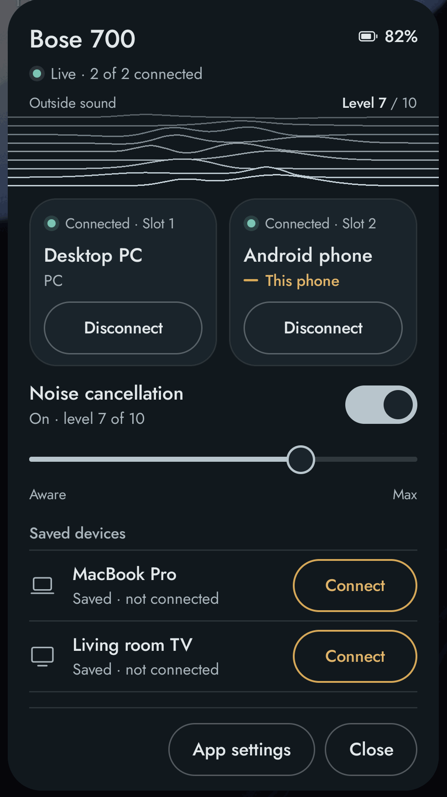
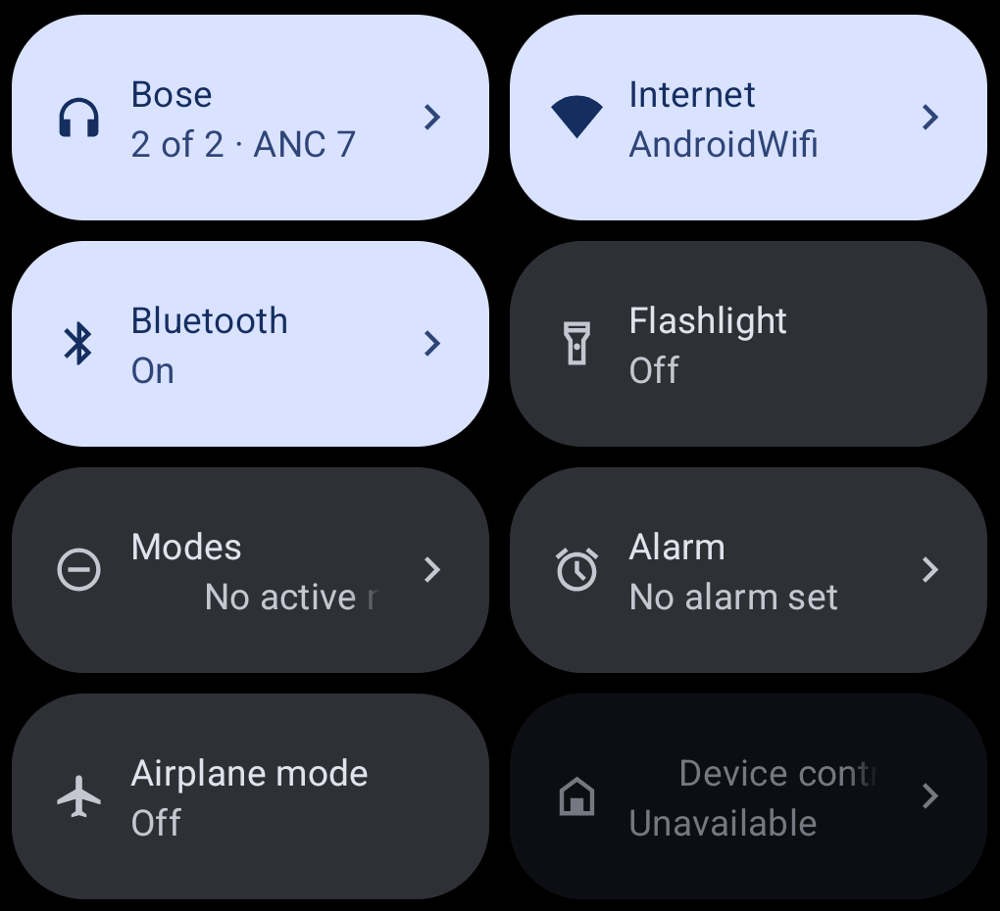
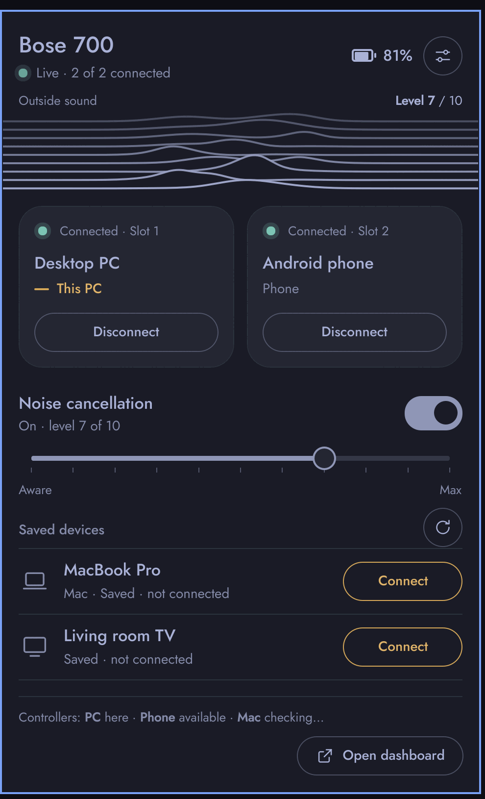
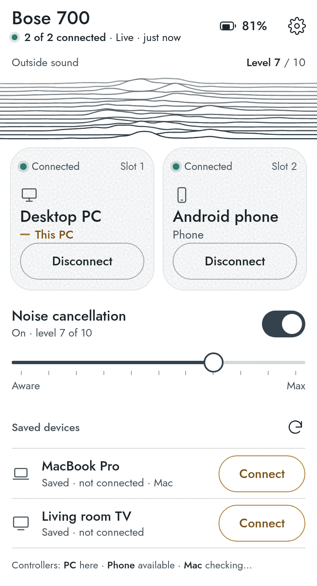

# Bose Connections

A minimal connection dashboard for the **Bose Noise Cancelling Headphones 700**.
See the headset's saved devices, connect or disconnect them, and choose which
connection to replace when both Bluetooth slots are occupied.

- Shared dashboard for Linux, macOS and Android, with a new app icon. It follows
  the system light/dark setting.
- **Use here**: one tap moves the headset to the device in hand and reports a true
  status. When both slots are busy it offers Replace per slot instead of guessing.
- Pending states appear instantly and settle only after the headset confirms;
  a failed or unconfirmed change reverts to the verified state.
- Noise cancellation levels 0–10 and Off, with verified headset state. The slider
  applies on release, and a switch turns noise cancellation on or off.
- Android Quick Settings tile and a native dialog with connections and ANC controls.
- Omarchy top-bar popup that uses the active Omarchy theme's colours.
- macOS menu-bar icon that opens a compact popover; right-click for the native menu.
- Optional authenticated controller-to-controller relay over Tailscale: an
  unconnected computer can send a request through a controller that reaches the headset.
- A controller with no OS Bluetooth link never reports its own device connected, not in its stale `/api/status` rows and
  not in the overview, even if the headset's list still shows it (2026-11-10).
- Immediate last-known device list, followed by a live refresh. When no controller can read the
  headset, the dashboard says so and gives each controller's reason (not connected, app not
  running, no answer); a controller with no Bluetooth link never shows in a last-known slot.
- Connection changes reread headset state, preserve a known control device, and
  verify the result. An ambiguous command is never retried through another peer.

## Screenshots

Device and network names are anonymized; unrelated phone content is removed.

<table>
  <tr>
    <th>Phone, light</th><th>Phone, dark</th><th>Desktop</th>
  </tr>
  <tr>
    <td></td>
    <td></td>
    <td></td>
  </tr>
  <tr>
    <th>Android dialog, light</th><th>Android dialog, dark</th><th>Android Quick Settings tile</th>
  </tr>
  <tr>
    <td></td>
    <td></td>
    <td></td>
  </tr>
  <tr>
    <th>Omarchy popup</th><th>macOS menu-bar popover</th><th></th>
  </tr>
  <tr>
    <td></td>
    <td></td>
    <td></td>
  </tr>
</table>

Independent community project; not affiliated with Bose. **Experimental:**
macOS reads and disconnect/reconnect have been verified on one NC700 running
firmware 1.8.2. Linux direct reads and phone disconnect/reconnect are also verified,
as are ANC levels 9 and 10. Relay switching has succeeded but repeated recovery
checks have been inconsistent. Android installs/builds and its Quick Settings tile
is registered, and its dialog appearance has been checked on Samsung Android.
Android direct Bluetooth and recovery behavior still need validation.
Sleep/reboot recovery and automatic controller retention remain experimental.
This does not support other Bose models.

Noise cancellation offers levels **0–10** and **Off**. Unknown packet layouts
refuse writes. Changes are read back from the headset; missing acknowledgements
trigger verification, never a blind repeat. Enabling ANC may reset the NC700 to
maximum, so a second write occurs only after a confirmed read of that transition.

## What is authoritative?

The headset owns saved devices and active connections. Each controller keeps a
private timestamped `snapshot.json` for display. Menus load that list immediately,
then query the headset directly or through a peer. Cached data never replaces the
fresh checks performed before/after a connection change.

Controller roles, peer addresses and the shared relay token live in each
controller's private `config.json`. **Role/settings edits are not synchronized.**
Provision the same role mappings and token on each controller. Live snapshots may
briefly differ between refreshes; this is not a distributed database or a promise
of continuous connectivity. If every controller loses headset access, reconnect
one through system Bluetooth settings or the Bose app.

## Desktop setup

Requires Python 3.12+; Linux direct access uses BlueZ/RFCOMM. On macOS, the
installer creates a private venv, installs the included MIT `pybmap` package and
PyObjC when needed, and builds a native application using Xcode Command Line Tools.
Pair your NC700 in system Bluetooth settings first. Obtain its Bluetooth address.

Create a **local-only** controller config (replace the example address):

```sh
python3 configure.py --id pc --headset AA:BB:CC:DD:EE:FF
python3 controller.py
```

Open `http://127.0.0.1:8847`. The config and cache are stored under
`~/.local/state/bose-control/`, outside the repository. Existing configs are not
overwritten by `configure.py`. The default NC700 RFCOMM channel is 8; it may need
verification on your headset/firmware.

For macOS, create a config with `--id mac`, then run:

```sh
python3 install_mac.py --config ~/.local/state/bose-control/config.json
```

This installs `~/Applications/Bose Connections.app` and a per-user LaunchAgent
`local.bose.connections`. The background helper adds a headphones icon to the menu
bar; click it for the compact popover (right-click for the native menu, whose first item
**Use on this Mac** moves the headphones here and offers **Replace <device>** when both
slots are busy), which opens the full dashboard. Allow Bluetooth when macOS asks.
IOBluetooth calls run on the Python main thread under the native app for proper
privacy attribution. Running the backend directly through SSH is not equivalent.

### Optional Tailscale relay

Use each controller's actual Tailscale IPv4 address. The addresses below are **illustrative placeholders**, not real device addresses.
Replace every headset, adapter and Tailscale address with your own:

```sh
python3 configure.py --id pc --headset AA:BB:CC:DD:EE:FF \
  --bind 100.64.0.1 --peer mac=100.64.0.2 --peer phone=100.64.0.3 \
  --role pc=11:22:33:44:55:66 --role mac=22:33:44:55:66:77 \
  --role phone=33:44:55:66:77:88
```

The first config generates a random token without printing it. Transfer a copy
privately to another machine and use `--token-from /private/path/config.json` when
creating that machine's config; swap its ID, bind address and peer list. Keep all
configs private. Do not put them in this repo. Settings can identify controller
roles from the headset's saved-device list.

### Connection state (`GET /api/state`)

The PC controller owns the connection state; front ends render it and run no switch flow of their own
([docs/state-machine.md](docs/state-machine.md); code in `statemachine.py`, the steps in `Controller.switch`).
`GET /api/state?after=<seq>&wait=<s>` is a long-poll: it answers at once when `seq > after` (or without `after`),
otherwise at the next change or after `wait` seconds (at most 25). The mesh port serves it to peers with the token.
The reply holds `seq`, `now`, `headset` (reachable, `via`, `read_age`, battery, noise, product, and each
controller as `here` (its read is the one shown), `available`, or `offline` with a `reason`), two `slots` (a free
one is `{"state":"free"}`), the other saved `devices`, `audio` (`{sink, default}`, `null` off Linux), and
`operation` (`null` when idle).

Each device is `connected`, `disconnected`, `connecting`, `releasing` or `unknown` (with `age`, after 60 s with no
headset read and no OS evidence). A device an operation is releasing or connecting shows that state first. Next,
an OS "no link" for a controller's own device wins over the headset's list: this PC's BlueZ link, or a peer's
`link:false`. Otherwise the newest headset read decides. A PC BlueZ link that came up after that read counts as
connected. Inputs: overviews (every read), `local_status`, and two watchers started by the service on Linux. The
BlueZ watcher runs `gdbus monitor --system` on the headset's `Device1` (`dbus-monitor` / `busctl monitor` as
fallbacks) and re-reads `Connected` after each restart. The PipeWire watcher runs `pactl subscribe` and re-reads
the sinks on each event. Both restart when their child exits. Headset reads run at start, after each operation,
on a BlueZ link change, every 20 s while a client long-polled in the last 60 s (120 s otherwise), never during an
operation.

`operation`: `{id, source, target, action, phase, started_at, deadline, steps, result}`. `action` is `switch`, or
`connect`/`disconnect` for an `/api/override`, which runs through the same one-at-a-time machine and shows one
`connecting`/`releasing` step. Steps (`reading`, `choose`, `releasing`, `connecting`, `audio`) carry
`state` (`pending`, `active` with `since`, `done`/`failed` with `seconds`) and a `label` from the contract's `steps`
table. `result`: `{ok:true, text, seconds}` or `{ok:false, error_key, text, step, detail, seconds}`. A failed
release reads "The Mac didn’t let go of the headphones" (`steps.release_failed`). A `choose` phase carries
`choices: [{address, label}]`. A finished operation stays 8 s, or until the next tap. An unanswered `choose` ends
at the 150 s deadline.

### Switch API (Use here)

`POST /api/switch` on the loopback port moves the headset to `target` (`pc`, `mac` or `phone`; default: this
controller's own device). Body: `{"source": …, "request_id": …, "target": …, "replace": …}`.
`source` is required and is one of the sources in
[`tests/switch-contract.json`](tests/switch-contract.json) (`web`, `mac-popover`,
`omarchy`, `android-app`, …); `request_id` is an optional short id
(`[A-Za-z0-9_-]{1,32}`, also the operation `id`); `replace` is the address of the slot to drop, sent after a
busy reply or a `choose` phase. Other keys are refused. The contract file holds the texts,
reply shapes and scenarios every front end is tested against.

The reply comes at once: `{"accepted": true, "operation": {…}, "seq": n}`. Then follow `GET /api/state`. A tap while
an operation runs gets `{"accepted": false, "operation": <the running one>}` and logs `outcome=rejected`.
`POST /api/switch/cancel` (empty body allowed) ends a `choose` phase. `POST /api/switch?wait=1` keeps the old
blocking reply shapes below for the current Mac and Android builds and the contract tests. A second blocking tap
waits for the running one, then reads afresh.

1. A fresh read (`reading`). On the PC, while the BlueZ watcher reports the link up, the read is skipped and only
   the sink is checked (the target is ≤ 0.5 s). Already on the target: success with no connect command.
2. Both slots busy and the target holds neither: keep the phone. With the phone and exactly one other device in the
   slots, that device is released (`releasing`, a verified disconnect sent once; this PC's own slot drops its BlueZ
   link). Any other pair, or the phone as target, is a `choose` phase that never guesses. With `?wait=1`, only
   sources `desk` and `couch` release (`rules.both_busy_desk`, `expect_desk`); the others get
   `{ok:false, busy:true, error_key:"busy", error, slots:[{address,label}]}`. A `replace` counts only while both
   slots are still busy and that device still holds one.
3. `connecting`. To this PC with a slot free, the PC first pages the headset itself (one `Device1.Connect`).
   Otherwise, or when that does not link, it connects through the same path as `/api/override` (local or one peer).
   If the connect is not confirmed, one fresh read decides: connected → success; target
   absent and a slot free → resend once, and only with at least 30 s of the deadline left;
   full slots → a busy reply; otherwise `unverified` (on the PC after paging for up to 45 s). Nothing is resent while a peer's reply
   may still be outstanding: a relay that got no answer (`transport: true`, including one cut
   off at the time left) stops the switch. A verified connect counts even after the deadline.
   One switch or connection change runs at a time per controller.
4. On a Linux PC with `pactl`: when no controller reaches the headset, or BlueZ has no
   link after the slot is confirmed, the PC pages it (`Device1.Connect` every 3 s, up
   to 45 s). It then waits for the headset's A2DP sink, recovering step by step
   (select A2DP, reconnect this PC's link, restart WirePlumber only while playback is
   stopped), and makes it the default sink with a read-back. macOS routes audio itself.
5. **Forgotten pairing (Linux PC).** If this PC's page brings the link up but the headset still refuses
   everything, including its control channel, and BlueZ logged an AVDTP refusal (111 or 13) during the attempt, the
   headset has dropped this PC's link key. Seen 2026-11-07 to 11-09: btmon showed the stored key rejected, then
   "Pairing Not Allowed". Full slots look different: the headset refuses the link itself. The reply is `forgotten`
   ("The headphones forgot this PC · hold their Bluetooth button until “Ready to connect”") within seconds. The PC
   first asks each peer that still reaches the headset (`/api/action` with `action: "pairing"`, BMAP 4.8 START) to put
   it into pairing mode. Then, in the same tap, it drops its stale key, pairs (just works), switches, and reconnects any
   device that pairing mode dropped. Measured 2026-11-09 on the NC700: playing on the PC 21 s after the tap, phone back
   at 24.5 s. Without such a peer, the reply is `forgotten` ("The headphones forgot this PC · hold their Bluetooth button
   until “Ready to connect”") within seconds, and the PC keeps scanning for up to 120 s. Once the headset answers in
   pairing mode, the PC re-pairs and runs the switch itself (`bose.switch source=repair`). The PC, Mac and Android
   controllers all accept `pairing`, for known controller addresses only.

   QA 2026-11-09, recovery started directly with the PC already re-paired (a controlled repeat of step 5, since the
   headset can't be made to forget on purpose): 4 of 8 runs played on the PC with the phone back, in 8–24 s. The
   misses were the headset's, not a single code path. Right after pairing it sends a device list that neither the PC
   nor the phone accepts, drops the new PC link about 4 s later, or refuses every profile on the new key (111). After
   each pairing the switch therefore runs up to three passes, 1.5 s apart, and pages from the PC first when the link
   is gone. A run that still fails ends as `unreachable` or `unverified`, and a normal tap a few seconds later
   connects. Back-to-back pairing cycles made it worse, so that may be the test itself.
   Normal taps, same day (PC dropped, phone kept, Android 0.7): 8 of 8 played on the PC, 3.0–10.9 s from the tap
   (median 4 s). The spread is the headset's own connect; it took 2–9.6 s to confirm. Before 0.7, one tap in four
   failed in 0.7 s, because the phone redialled the control channel 30 ms after closing it. 0.7 redials quick
   refusals.
6. One 150 s deadline (`timeout`); reads and the relay timeout are bounded by the time left,
   and the web and Omarchy clients wait 160 s. Success:
   `{ok:true, verified:true, message:"Playing on Bose 700", state:<overview>}`. Failure:
   `{ok:false, error_key, error:<contract text>, detail:<raw reason>}` with keys
   `unreachable`, `timeout`, `unverified`, `keep_one`, `no_audio`, `audio_not_moved`, `forgotten`.

`POST /api/override` also accepts optional `source` and `request_id` (absent = `unknown`),
and its connect/disconnect failures now carry `error_key` and the contract `error` text
(raw reason in `detail`); full slots give the busy reply with `slots`. Request ids are cut to
`[A-Za-z0-9_-]{1,32}` before relaying.

**Timing line.** Each operation (switch or connect/disconnect override) also logs one
`bose.timing id=k3f9a2 reading=0.50s releasing=0.90s connecting=2.50s audio=0.00s total=3.90s`, with only the
steps that ran.

**Log rule.** Every controller that receives a `/api/switch`, a connect/disconnect
`/api/override`, or a relayed connect/disconnect `/api/action` logs exactly one `bose.switch`
line for it, with role labels only. The executing peer's line carries the origin's `id` and
`via=local`; noise changes log none. Python and Android follow the same rule:

```
bose.switch source=web id=k3f9a2 target=PC replace=- outcome=ok via=peer:phone total=1.84s
```

`outcome` is `ok`, `busy` or `error:<key>` (`error:invalid` for a refused body); `via` is
`local` or `peer:<id>`. The relayed `/api/action` carries `source` and `request_id`, so the
peer's `bose.switch` and `bose.timing` lines show the same `id=`. Older peers ignore the extra
fields; a peer drops an invalid `source` or `request_id` on `/api/action` instead of refusing it.

Dashboard: loopback port **8847**, with Host/Origin checks. Mesh: configured
Tailscale IPv4 port **8848**, tailnet source checks and shared bearer token.
HTTP is used inside Tailscale's encrypted network; there is no public server or
cloud API. Do not expose these listeners through public port forwarding.

### Linux top-bar popup (Omarchy)

The widget uses Omarchy's Quickshell plugin system. Start the Python helper at
login using your preferred user service, then copy `linux/` to
`~/.config/omarchy/plugins/local.bose/`. Validate and enable it:

```sh
omarchy plugin validate ~/.config/omarchy/plugins/local.bose
omarchy plugin enable local.bose right
```

Back up your shell config before layout changes. Copy the whole `linux/` folder:
it holds several QML files and a `fonts/` directory. Click the headphones icon to
open the popup. **Use here** moves the headset to this PC and plays PC audio on it.
Two slot cups show the connected devices, each with Disconnect;
saved devices have Connect. When both slots are full, choose which device to
replace in place. The ANC switch and slider apply on release, and **Open dashboard**
opens a compact app window through `omarchy-launch-webapp`. Colours follow the
active Omarchy theme. The same backend protections apply to popup and
dashboard actions. Other Linux desktops can use the web dashboard; a generic
system-tray implementation is not included.

On Linux, preparing a connection briefly enables BlueZ discovery for up to 30
seconds and restores the previous setting, allowing incoming connections to a
powered but non-connectable adapter. Status checks do not dial disconnected PC/Mac
hosts. Actions select the first eligible controller and always check actual headset
state before changing connections. Linux requires the `busctl` utility (systemd);
`adapter` in private config defaults to `hci0` for the paired headset.

## Android

Requires Android 8+; build target is Android 15 (API 35). Install JDK 17+ and the
Android SDK platform 35/build-tools. Set `ANDROID_HOME`, then run:

```sh
python3 build_android.py
adb install -r dist/bose-connections.apk
```

This builds a personally signed, debuggable APK. Signing material stays in your
private state directory; preserve it for compatible updates. No credentials or
headset address are embedded in the APK. No prebuilt APK release is published yet.

Open **Bose Connections** and allow Nearby devices and notifications. In Settings
→ Set up controller links, enter the paired headset's Bluetooth address. For relay,
enter the private token and PC/Mac Tailscale addresses; those fields may be left
empty for phone-only Bluetooth access.

Alternatively, create a private config with `configure.py --id phone` and
provision it into the installed app's `files/config.json` using Android `run-as`.
The app's foreground service is the relay that the PC and Mac call (status, switches, `pairing`
for a forgotten PC). It keeps a quiet notification and starts by itself after a reboot or an
app update, and whenever the Quick Settings panel opens, once a connection code is set. It
listens on the Tailscale tunnel (`tun*`). Carriers give mobile data addresses from the same
100.64/10 range, so `rmnet*` addresses never count (`android/Tailnet.java`). The phone talks
to the headset on RFCOMM channel 8, like the PC and Mac. The NC700's control UUID resolves to
a different Bose service (channel 14) that never answers. Set `channel` in the private config
to override it.

Verified 2026-11-09 on the Galaxy S22 Ultra (0.6): the relay came back on its own after the
update. From the PC over Tailscale, `/api/status` read the headset in 0.3–1 s, and a
`pairing` request for an unknown address was refused without touching the headset. Pairing
mode and switching through the phone were not run, because the headphones were in use.

### Android Quick Settings

Add **Bose** using the Quick Settings panel's edit button after installation. One
tap moves the headphones to this phone: the subtitle shows "Connecting…" at once, then
"Playing on Bose 700" or the reason (with " · tap to retry"). If both slots are busy the
tile says so and opens the compact panel with the replacement choice already asked
(a tile cannot show two buttons). The panel also has connect/disconnect, ANC level and
Off controls, sharing the app's private config and cached state. A locked phone must be
unlocked first. Long-press opens the app.

The app and tile share `Core.switchHere` (rules and texts in `tests/switch-contract.json`,
logic in `android/Switcher.java`). It reads the same phone+PC+Mac overview as the other
changes and hands the connect to `Core.override`'s controller choice, so it works when the
phone holds no slot: already connected is a success with no command; a
connect that is not confirmed is resent once after a fresh overview; 150 s is the deadline;
one `bose.switch …` line per request goes to logcat tag `BoseSwitch` (roles only, no
addresses). The in-app web page reaches it as `/api/switch` through the same
`Android.request` bridge as every other call, with the controller's reply shape.

## Development

```sh
python3 -m unittest discover -s tests -v
```

The 117 tests use simulated transports and have no hardware side effects.
`tests/test_state_machine.py` drives the state machine through `tests/fakeworld.py`: a simulated headset, BlueZ link
and PipeWire sink shared by three real controllers on a fake clock. It covers every transition, the long-poll, the
watchers' parsing and restarts, and `?wait=1`. `python3 tests/smoke_switch.py` runs the real HTTP server on a random
loopback port over that world and prints the step timings. Seventeen run
`/api/switch` through every scenario in `tests/switch-contract.json`, with and without the
Linux sink step and relayed through an Android-shaped phone, with a fake clock and a fake `Audio`. They check texts, connect
counts, the final slots, the default sink and the single `bose.switch` log line.
`tests/test_omarchy_contract.py` runs `tests/bose_model.qml` offscreen
(`QT_QPA_PLATFORM=offscreen QML_XHR_ALLOW_FILE_READ=1 qml6 tests/bose_model.qml`). It drives
the Omarchy popup model through the same scenarios and is skipped when `qml6` is missing. The
protocol/controller tests cover packet fragmentation, rejected commands, slot/anchor
protection, mutation verification, ambiguous-command handling and private cache
persistence, ANC handling and avoiding competing background connections. CI runs them on Python 3.12 and 3.13.

`tests/test_android_contract.py` compiles `android/Switcher.java` with a test-only
`org.json` stand-in and runs every scenario of `tests/switch-contract.json` against a fake
overview and override (skipped without a JDK); `tests/test_mac_contract.py` statically checks that
`mac/Launcher.m` posts `/api/switch` with the contract body and texts.

For GUI checks, install Node dependencies (`npm install`) and Chromium, then run
`npm run test:gui` (headless). Without `BOSE_URL`, the page is served from this checkout's
`web/`, so no helper needs to run. Set `BOSE_URL` to test a running helper's copy, and
`CHROMIUM_PATH` if needed. The runner intercepts API responses with synthetic data and
verifies mobile/desktop layouts, settings and the replacement dialog. It also runs Use here
through every contract scenario: pending text before the reply, final texts, Replace offers,
the replace payload, the Mac popover source and the Android `switchHere` bridge. A scripted `GET /api/state`
long-poll then drives the shared-state page: chips, step timings, result, auto-clear, Try again, the choose phase
and cancel, Move-to targets, unreachable reasons and the popover (its captures go to `artifacts/state/`); every
other run answers `/api/state` with 404, which also covers the fallback to overview polling. It creates
ignored screenshots under `artifacts/` (`BOSE_ARTIFACTS` overrides the folder); it sends no
connection mutations. Set
`SCREENSHOT_SCALE=2` for 2x captures, as used for the images above. The design
system is described in [DESIGN.md](DESIGN.md).

## Remove

- Linux: stop your helper service; disable/remove the `local.bose` plugin.
- Mac: unload/remove `~/Library/LaunchAgents/local.bose.connections.plist` and
  remove `~/Applications/Bose Connections.app`.
- Android: stop the relay in controller-link settings or uninstall the app.

Retain private configuration/signing files if reinstalling. The controller does
not delete pairings or update firmware. ANC settings change only on explicit actions.

## License and credits

GPL-3.0; see [LICENSE](LICENSE). BMAP protocol references and the vendored MIT Mac
transport are credited in [THIRD_PARTY.md](THIRD_PARTY.md), with revisions in
[upstream-revisions.json](upstream-revisions.json).
